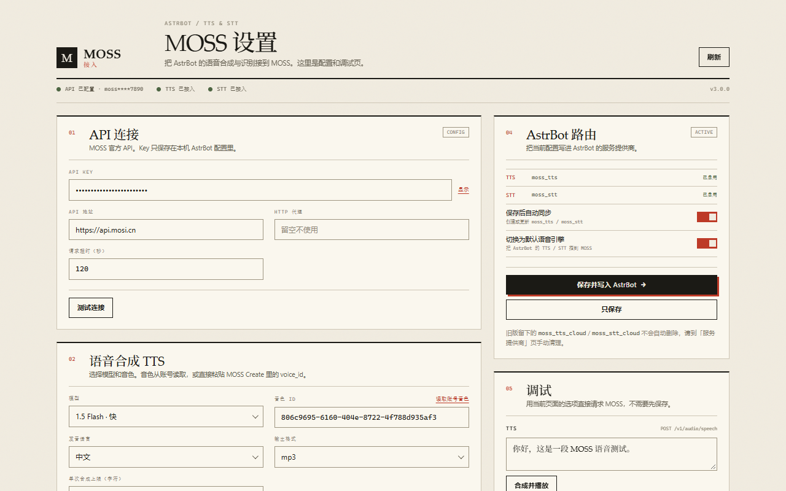

# MOSS 语音接入 for AstrBot

把 MOSS 官方 TTS / STT 接进 AstrBot。插件注册 `moss_tts` / `moss_stt` 两个服务提供商，并提供一个单页 WebUI 用来配置和做最小化调试。



> 官方文档：[platform.mosi.cn/docs](https://platform.mosi.cn/docs)
> API 域名：`https://api.mosi.cn`

## 这个插件做什么

- **TTS Provider**：AstrBot 需要发语音时，调用 `POST /v1/audio/speech`，返回本地 mp3/wav 文件。
- **STT Provider**：AstrBot 收到语音时，调用 `POST /v1/audio/transcriptions`，返回转写文本。
- **单页设置**：API 连接、TTS、STT、Provider 路由、测试，全部在一页里。
- **账号音色**：从 `GET /v1/audio/voices` 读取当前账号音色；也可以直接粘贴 MOSS Create 里复制的 `voice_id`。
- **最小调试**：一小段 TTS 测试和单文件 STT 测试，用来确认 Key / 音色 / 模型可用。

不包含：音色克隆、音色库页面、批量转写、语音工作台。音色请在 [MOSS Create](https://create.moss.cn/voice/library) 克隆，然后把 `voice_id` 复制回来。

## 环境

- AstrBot `>=4.16,<5`（当前按 4.29 的 Provider / 插件页面接口编写）
- `httpx`（AstrBot 自带）
- ffmpeg 可选：mp3 / wav / m4a / amr / ogg / opus / webm / flac / aac / wma / mp4 / mov / mpg 会直接上传；只有 QQ/微信的 `silk` 等格式才需要转换。

## 安装

### 目录要求

AstrBot 只扫描 `data/plugins/<插件目录>/main.py`。插件目录必须直接包含：

```text
data/plugins/astrbot_plugin_moss_voice/
├─ main.py
├─ metadata.yaml
├─ _conf_schema.json
├─ core/
├─ providers/
└─ pages/
```

不要出现 `.../moss-for-astrbot/moss-for-astrbot/main.py` 这种多套一层的情况。

### 本地复制

Windows PowerShell：

```powershell
$src = "C:\path\to\moss-for-astrbot"
$dst = "C:\path\to\AstrBot\data\plugins\astrbot_plugin_moss_voice"
New-Item -ItemType Directory -Force $dst | Out-Null
Copy-Item "$src\*" $dst -Recurse -Force
```

Linux / Docker 宿主机：

```bash
cp -r /path/to/moss-for-astrbot /path/to/AstrBot/data/plugins/astrbot_plugin_moss_voice
```

Docker 部署时，把插件放进宿主机映射到容器 `/AstrBot/data/plugins/` 的目录，然后 `docker compose restart`（或重建容器）。

### 启动并配置

1. 重启 AstrBot，或在 WebUI 插件页重载插件。首次安装建议直接重启，确保 Provider 适配器在启动阶段注册。
2. 打开插件详情页的 **MOSS 设置**。
3. 填 API Key：
   - Key 在 [platform.mosi.cn](https://platform.mosi.cn) 控制台创建。
   - 也可以不填，改用环境变量 `MOSS_API_KEY`。
4. 填音色 ID：
   - 在 MOSS Create 克隆音色后复制 `voice_id`，粘贴到“音色 ID”。
   - 也可以点“读取账号音色”，从当前账号列表里选。
5. 保存。插件会自动创建/更新 `moss_tts` / `moss_stt`，并可按配置切换默认语音链路。
6. 在「调试」区做一次 TTS 和 STT 测试。

如果不想自动切换：关闭「切换为默认语音引擎」，或到 AstrBot「服务提供商」页手动选择 `MOSS 官方语音合成` / `MOSS 官方音频转写`。

### 从旧版升级

1. 先停用/删除旧版插件目录，重启 AstrBot。
2. 用新版覆盖到插件目录；**保持同一个目录名**时，旧 `cloud` / `stt` / `sync` 配置会自动迁移。
3. 如果改了目录名，AstrBot 会读新的 `<目录名>_config.json`，旧 Key 不会自动跟过来：重新填一次，或把旧配置复制/改名为新文件名。
4. 旧版留下的 `moss_tts_cloud` / `moss_stt_cloud` 服务提供商不会自动删除；到 AstrBot「服务提供商」页手动删掉即可。

## 页面

单页，不分标签：

- **01 API 连接**：API Key、API 地址、代理、超时、连接测试。
- **02 语音合成 TTS**：模型、音色 ID（可读取账号音色）、语言、输出格式、单次字符上限。
- **03 音频转写 STT**：模型、关键词、上传上限、说话人分离、说话人标注、时间码。
- **04 AstrBot 路由**：`moss_tts` / `moss_stt` 状态、自动同步、默认语音引擎切换。
- **05 调试**：一段 TTS 测试、一个音频 STT 测试。

页面使用 AstrBot 的 `AstrBotPluginView` bridge。所有模型选择都是页面内自绘的下拉层，不使用原生 `<select>`，避免亮暗主题下白底浅字。

## Provider

| 类型 | 显示名 | 能力 | 默认模型 |
|---|---|---|---|
| `moss_tts` | MOSS 官方语音合成 | TTS | `moss-tts-1.5-flash` |
| `moss_stt` | MOSS 官方音频转写 | STT | `moss-transcribe-1.0` |

TTS 的 `get_audio(text)` 返回本地 mp3/wav 路径；STT 的 `get_text(audio_url)` 接受本地路径、`file://`、HTTP(S)、`base64://`、`data:` 音频。

## 配置

配置文件由 AstrBot 管理，位于 `data/config/`，文件名跟随插件目录（通常为 `<目录名>_config.json`）。

```json
{
  "connection": {
    "api_key": "",
    "api_base": "https://api.mosi.cn",
    "proxy": "",
    "timeout": 120
  },
  "tts": {
    "model": "moss-tts-1.5-flash",
    "voice_id": "",
    "language": "",
    "response_format": "mp3",
    "max_chars": 5000
  },
  "stt": {
    "model": "moss-transcribe-1.0",
    "diarize": true,
    "keyterms": [],
    "include_speaker": true,
    "include_timestamp": false,
    "max_upload_mb": 100
  },
  "routing": {
    "auto_sync": true,
    "auto_enable": true,
    "tts_provider_id": "moss_tts",
    "stt_provider_id": "moss_stt"
  }
}
```

`voice_id` 没有默认值，必须填自己账号下的音色 ID。

## 模型

| 模型 | 用途 | 注意 |
|---|---|---|
| `moss-tts-1.5-flash` | 快、便宜 | 支持 `language` 和 `[pause X.Ys]` |
| `moss-tts-1.0-pro` | 更稳、质量优先 | 不支持 `language` / pause 语法 |
| `moss-transcribe-1.0` | 普通转写 | 返回 `text` |
| `moss-transcribe-diarize-pro` | 多说话人 | 返回 `segments`，支持 `diarize` / `keyterms` |

快照版本（例如 `moss-tts-1.5-flash-2026-06-26`）也可以直接在配置里选，用于复现固定版本。

## API 契约

插件只使用下面这些官方接口：

```text
POST /v1/audio/speech
  model, input, voice_id, language, response_format, delivery_method=audio
  -> audio/* 二进制，或 {status, url, response_format, content_type}

POST /v1/audio/transcriptions
  multipart: model, file, response_format, diarize, keyterms
  -> {text} 或 {text, segments[{speaker,start,end,text}]}

GET  /v1/audio/voices
  -> {data:[{id,name}], has_more, next_cursor}
```

第一版刻意不走 `stream` / `async` / webhook，先把同步链路做稳；页面和 Provider 都使用同步返回。

## 测试

```bash
pip install pytest pytest-asyncio
python -m pytest tests/test_core.py tests/test_providers.py
```

`tests/test_core.py` 覆盖 MOSS 客户端、错误解析、音频格式识别、配置迁移和转写格式化；`tests/test_providers.py` 用最小 AstrBot stub 验证 Provider 注册、页面路由、配置保存和启动期 Provider 同步。

页面单独预览（不启动 AstrBot）：

```bash
python tests/ui_preview.py
# http://127.0.0.1:8765/pages/settings/index.html
```

预览使用 `tests/mock_bridge.js` 模拟 `AstrBotPluginView` 和 MOSS 接口，不会请求真实 API。

## 目录

```text
main.py                    插件入口 / 配置迁移 / 页面注册
_conf_schema.json          插件配置页
core/
  client.py                MOSS HTTP 客户端
  audio.py                 音频读取、格式识别、silk/ffmpeg 转换
  config.py                默认值、校验、Provider 配置
  formatting.py            转写 segments -> 文本
  page_api.py              WebUI 后端路由
  provider_sync.py         AstrBot Provider 写入 / 路由
providers/
  moss_tts.py              TTSProvider
  moss_stt.py              STTProvider
pages/settings/            单页 WebUI（index.html / style.css / app.js）
tests/                     单元测试 + 页面预览 mock
```

## 安全与隐私

- API Key 保存在 AstrBot 的插件配置文件中；页面通过已登录的 Dashboard bridge 读取，不写入日志。
- 音频与文本只发送到 `api.mosi.cn`；不会经过第三方中转。
- 合成结果、转写结果只在本机内存/临时目录中处理。
- 代理配置可选；留空时直连。

## 已知限制

- TTS 暂时不支持流式播放；AstrBot 端会等完整音频生成后再发语音。
- 页面里超过 8 MB 的转写测试文件走 `bridge.upload`，此时使用**已保存**的转写设置；小文件使用页面当前选项。
- 音色 ID 为空时，TTS Provider 会明确报错，不会偷偷使用内置音色。
- 插件卸载后，已写入的 `moss_tts` / `moss_stt` Provider 条目需要到 AstrBot「服务提供商」页面手动删除。
- v3 是对旧版的重写：旧版 `moss-tts` / `moss-transcribe` / `version` 参数已不再使用，旧配置会在加载时自动迁移；旧版的服务提供商条目需要手动清理。

## License

MIT。见 [LICENSE](LICENSE)。
